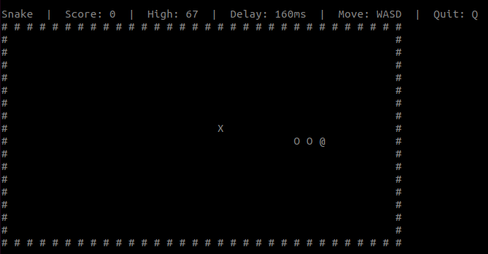

# Cnake

[](LICENSE)
[](https://en.cppreference.com/w/cpp/17)
[](https://cmake.org/)



Minimal terminal Snake game written in C++17.

## License

GPLv3. See [LICENSE](LICENSE) for details.

## Get The Code

```bash
git clone git@github.com:fbjelonic/codex_snake.git
cd codex_snake
```

## Requirements

- A C++17 compiler
- CMake 3.16 or newer
- A POSIX-like terminal environment

## Build

```bash
cmake -S . -B build
cmake --build build
```

## Run

```bash
./build/snake
```

## Play

- A config file must be present next to the executable.
- High scores and game history are stored in `cnake_stats.txt`.
- Use the keyboard to steer the snake in the terminal.
